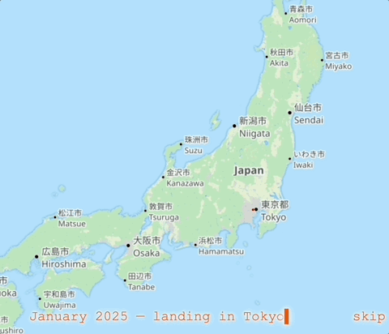
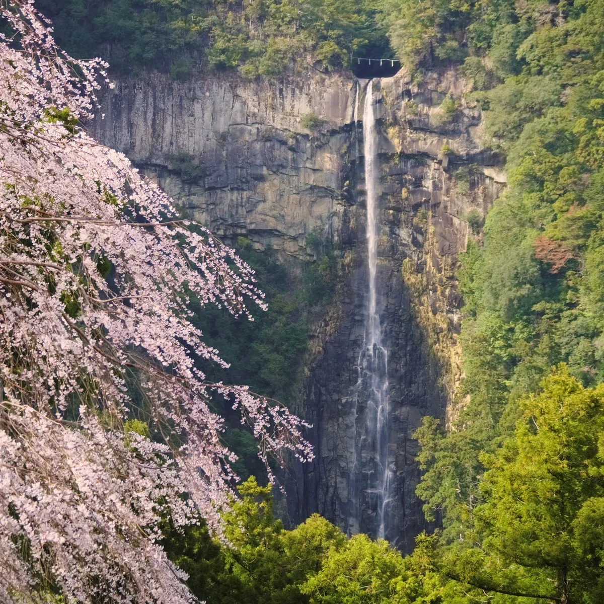
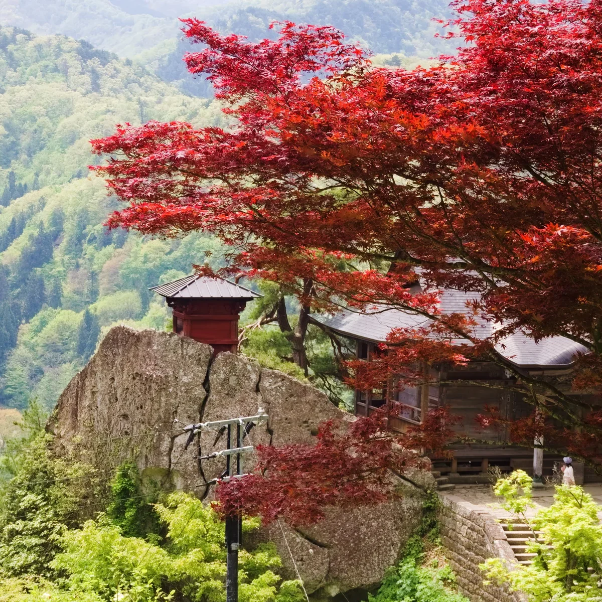
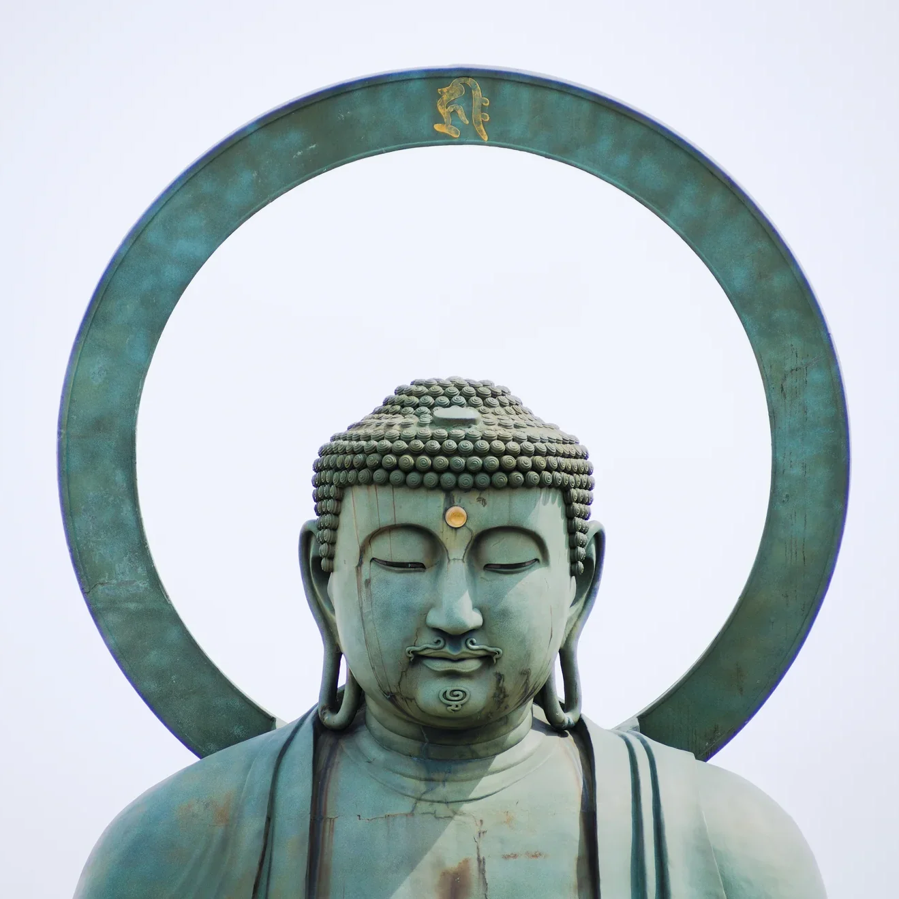
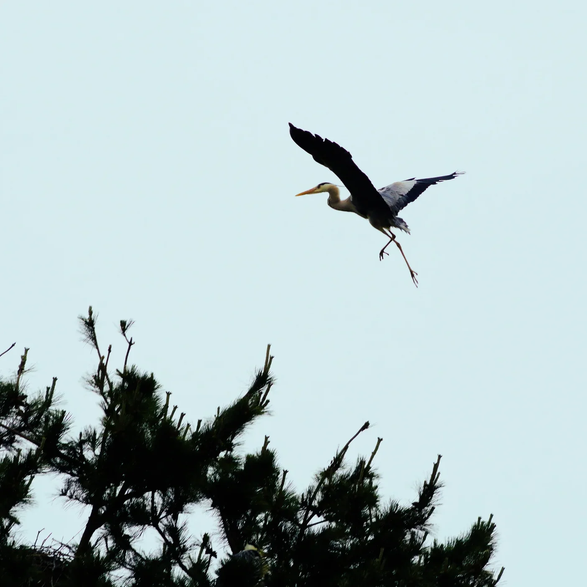
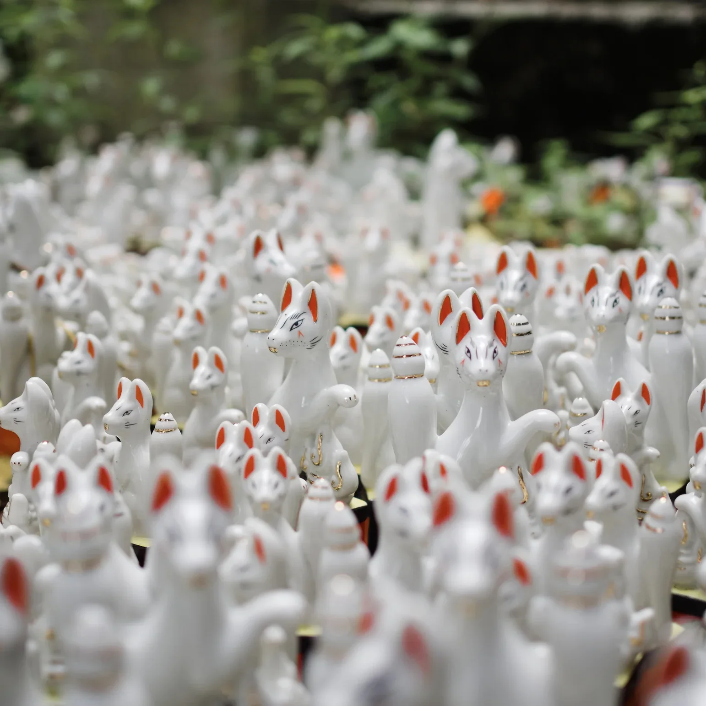
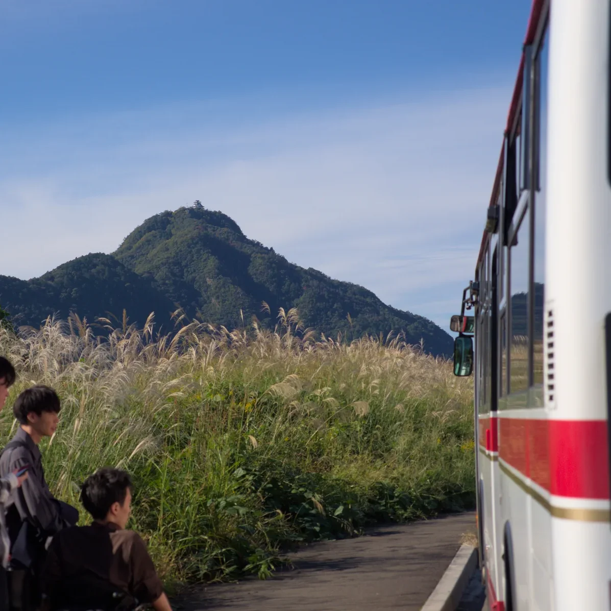
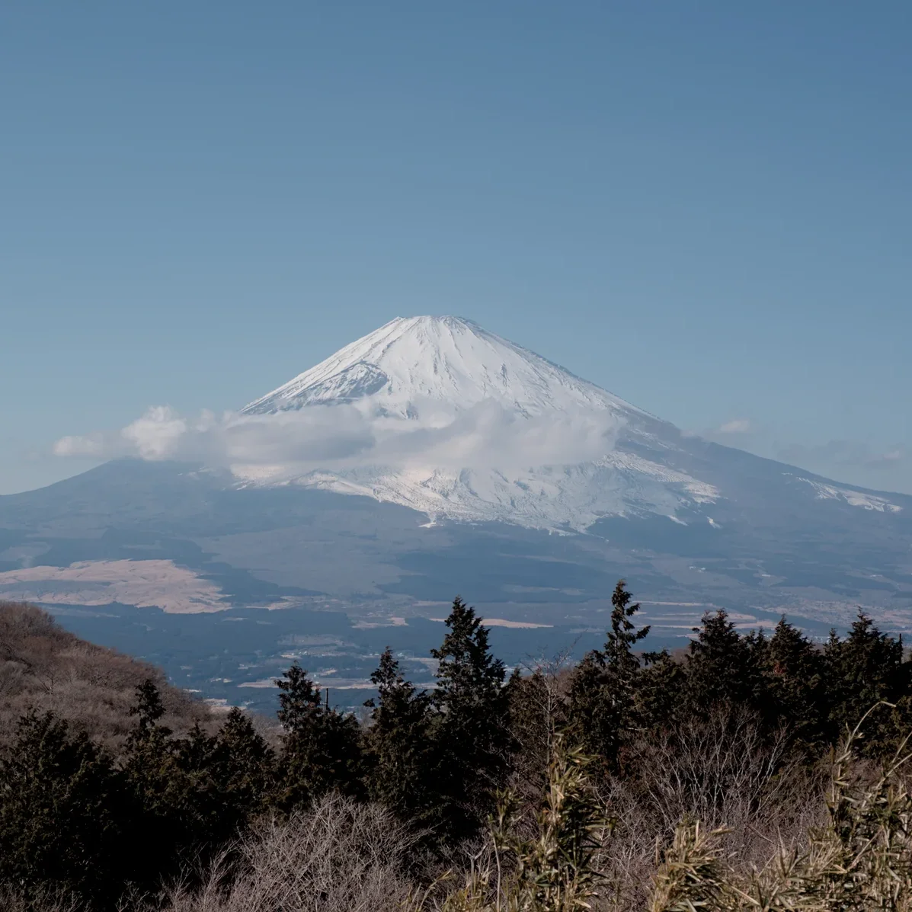
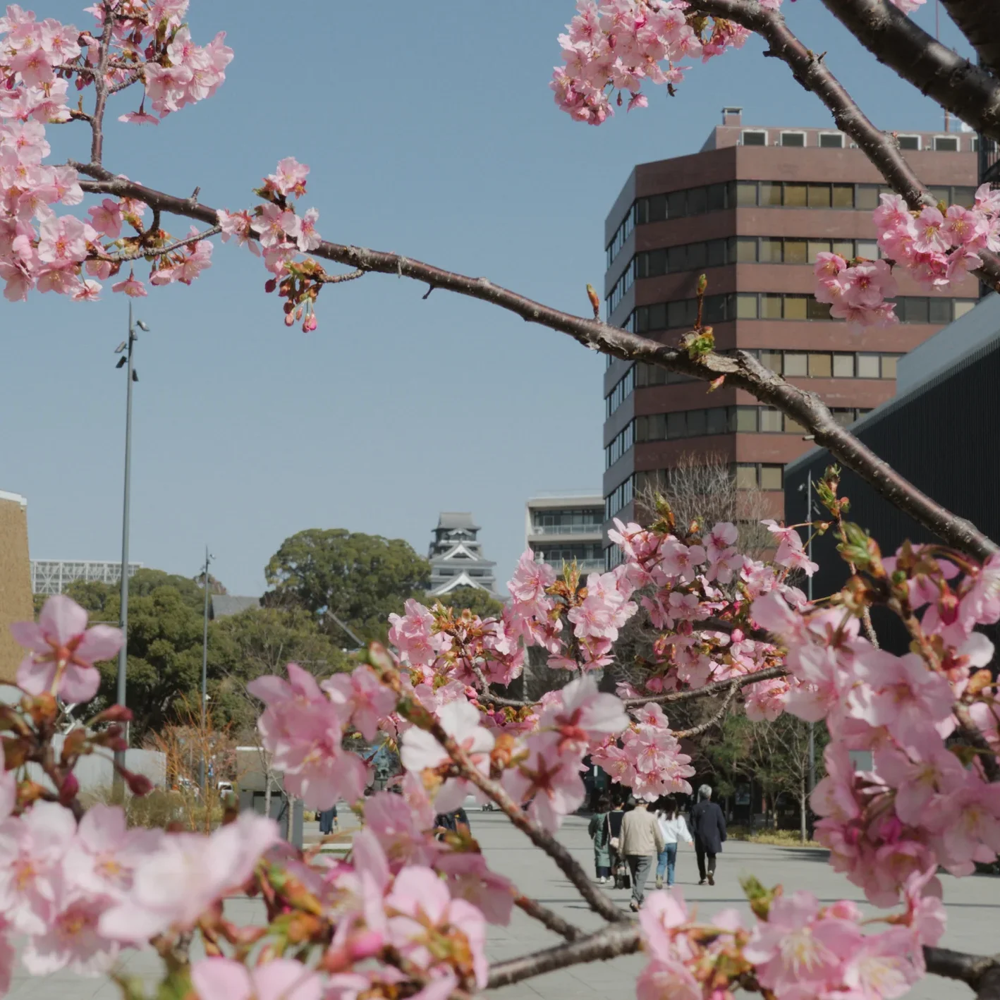
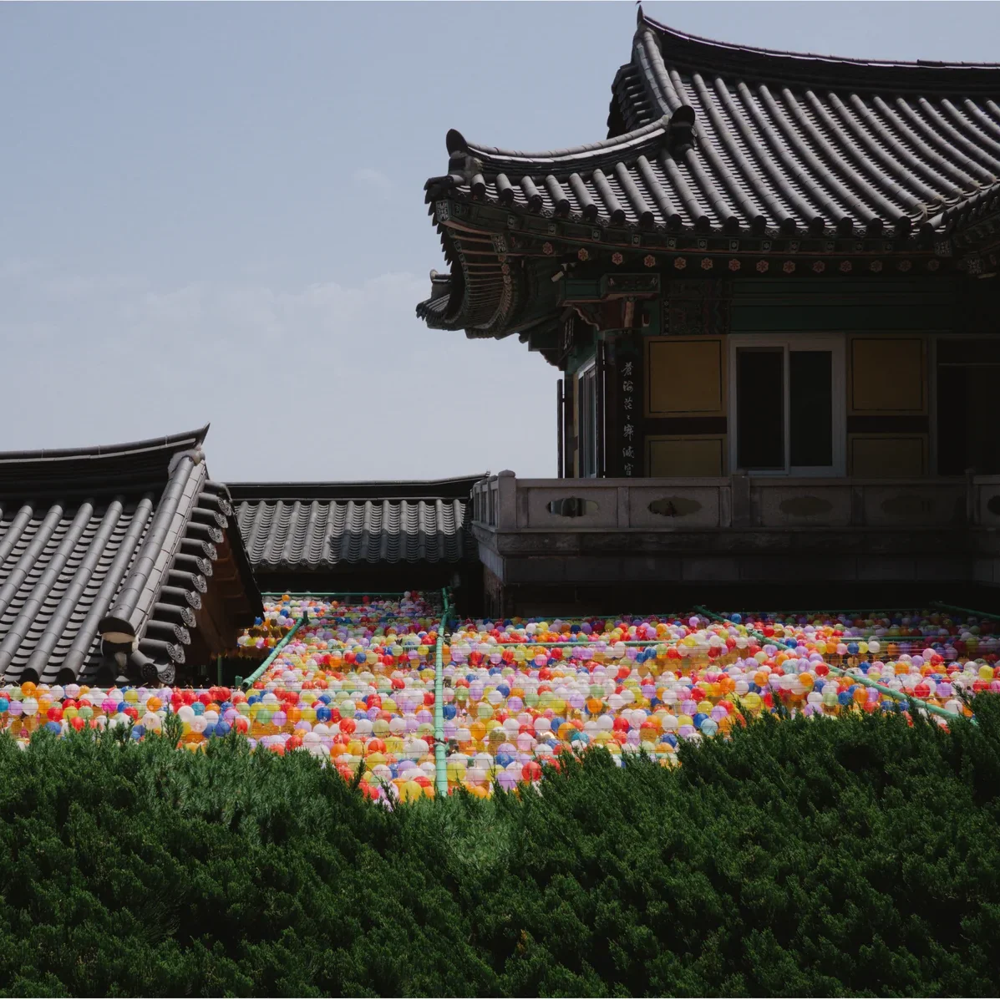

## Japanese Polaroids

A [map of everywhere I've been in Japan](https://seitaro-white.github.io/travel-tracker-frontend/) since January 2025 and some of the photos I've taken along the way.

  

I only started photography as a hobby when I arrived in Japan. So many of the early photos on this map are very bad! However if you look at the timestamps you will hopefully see that I have improved somewhat in my more recent photography.

  
  
  
   
  
  
  
   
  
  
  

## How?

| | |
|---|---|
| **The Camera** | I bought a battered second-or-possibly-third hand [Olympus OM-D E-M5 II (2015)](https://www.olympus.co.jp/technology/design/product/omd_em5_mk2.html) in Akihabara for ~¥37,000. It's pathetic in low-light and the on-off switch sometimes doesn't work, but I have felt no need to upgrade. |
| **The Lenses** | 2025 photos mostly taken on the [M.Zuiko Digital 14-42mm f/3.5-5.6](https://explore.omsystem.com/c/en/m-zuiko-14-42mm-f3-5-5-6-ii-r) and [M.Zuiko Digital 40-150mm f/4-5.6 R](https://jp.omsystem.com/product/lens/zoom/mzuiko/40-150_40-56_r/index.html) kit lenses. Since 2026 I've switched to mainly using the (now sadly discontinued) [Panasonic Lumix G 20mm f/1.7 ASPH](https://panasonic.jp/dc/products/H-H020.html), which I absolutely adore. For hiking/outdoors photography I'm generally using a weathersealed [M.ZUIKO DIGITAL ED 12-45mm F4.0 PRO](https://jp.omsystem.com/product/lens/zoom/pro/12-45_4pro/index.html). |
| **Editing** | [Darktable](https://www.darktable.org/), an OS alternative to Adobe Lightroom - I generally shoot in raw. I have become an increasingly minimal (i.e. lazy) editor and generally just apply a set of LUT film simulations + light retouching. |
| **GPS logging** | [Geotag Photos Pro](https://www.geotagphotos.net/) for tagging my photos with coordinate data and exporting GPX data to... |
| **GIS** | [QGIS](https://www.qgis.org/). I feel somewhat guilty criticising OS software, but I *hate* using QGIS. It is a slow, clunky mess with an truely horrid UI. ArcGIS however, cost £1,000 a year. So I use QGIS to clean up my GPX trails and select which photos I want displayed. |
| **The App** | A small pipeline to put everything together, link up the animation trails at the start. The UI is vanilla typescript. |
